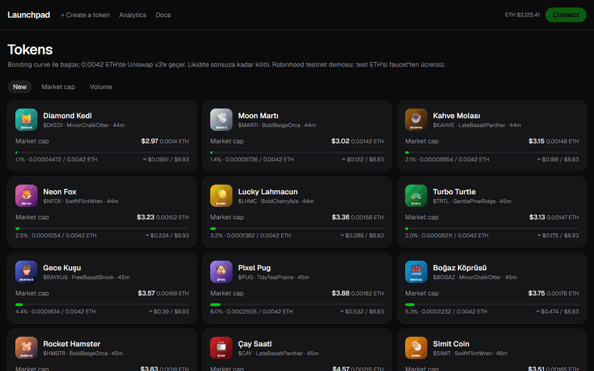
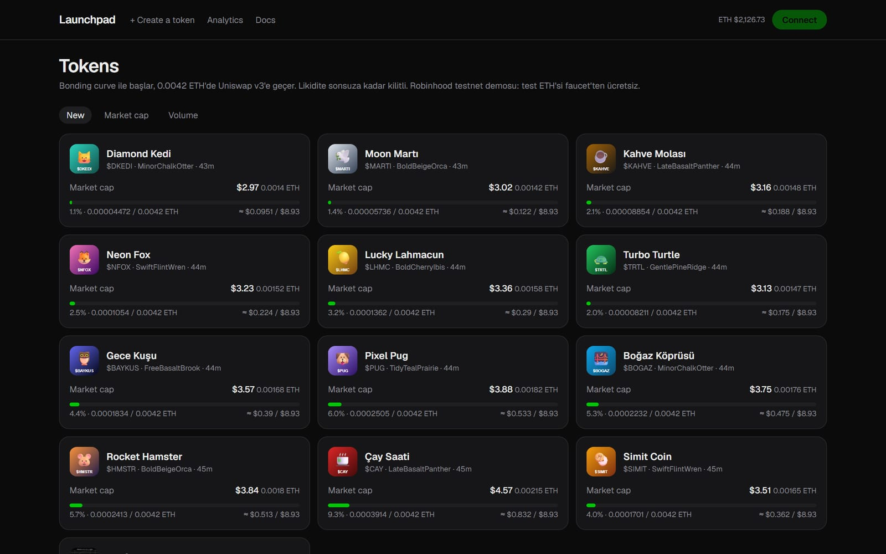
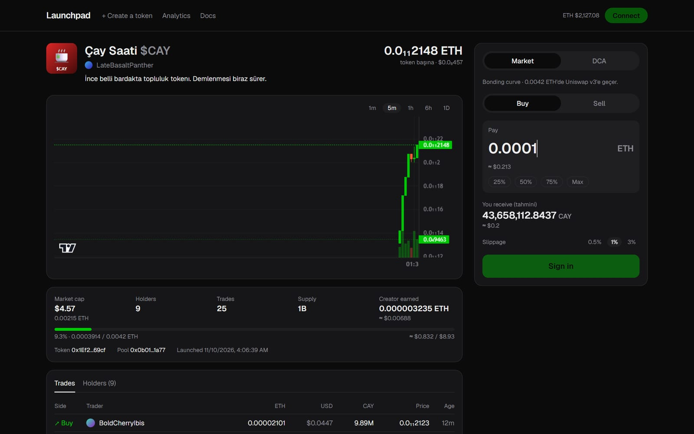
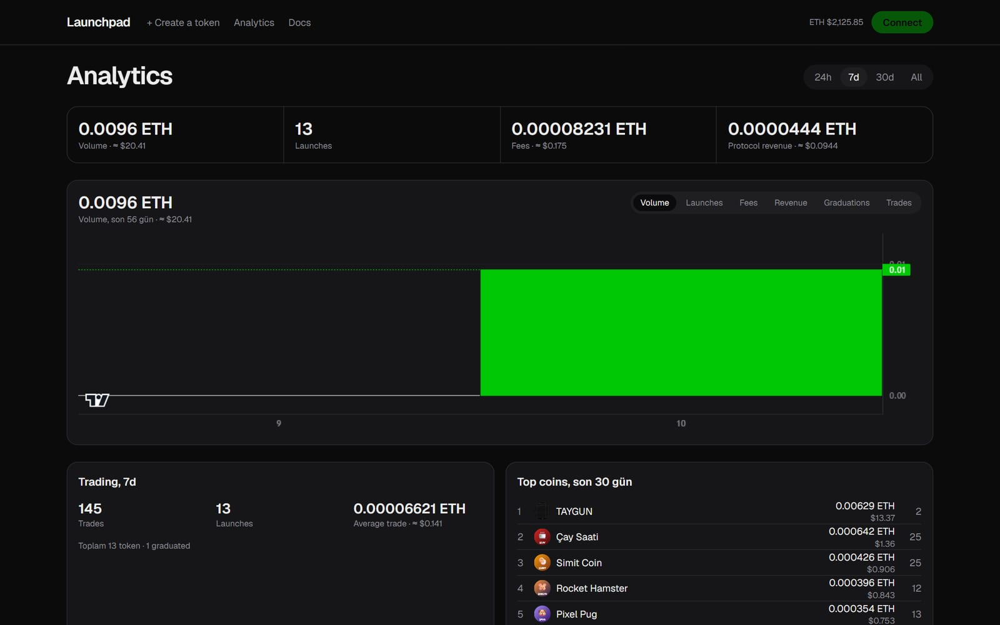
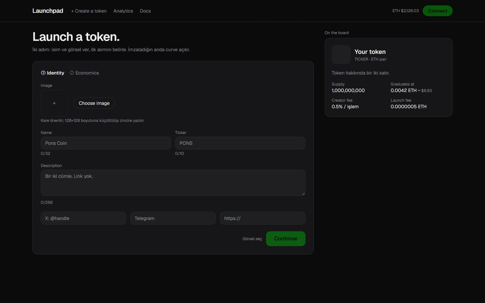

# Launchpad

🇬🇧 English · 🇹🇷 [Türkçe](README.tr.md)

[](https://github.com/alisimsek55/launchpad/actions/workflows/ci.yml) [](LICENSE)   

A bonding-curve token launchpad on **Robinhood Chain** (an Arbitrum Orbit L2), in the spirit of pump.fun. Anyone can launch a token in seconds. It trades on a bonding curve first; once the curve collects its target (4.2 ETH on mainnet, 0.0042 on testnet), the liquidity **migrates to Uniswap v3 automatically** and the LP position is **locked forever**.

**🔗 Live demo (Robinhood Chain testnet): https://launchpad-cyan-nu.vercel.app**



> ⚠️ Learning / portfolio project. The contracts have not been audited. The public demo runs on **testnet**; do not use it with real funds.

## What it does

| | |
|---|---|
|  |  |
| **Token list:** live market caps (USD + ETH), curve progress, sorting by new / market cap / volume | **Token page:** TradingView candles, buy/sell with live quote and slippage, trades and holders |
|  |  |
| **Analytics:** protocol volume, fees, launches, graduations, top coins | **Create:** two-step launch; image and metadata stored **fully on-chain** |

- **Bonding curve:** virtual-reserve `x·y=k`; 80% of supply is sold on the curve, 20% seeds the Uniswap pool. The graduation price equals the Uniswap opening price exactly, so there is no price jump at migration.
- **One-transaction graduation:** the buy that completes the curve also creates the full-range Uniswap v3 position and locks the LP NFT in `LPLocker`, so the creator cannot pull the liquidity (no rug pull).
- **Fair launch:** a sniper fee decays from 20% to 1% over the first 60 seconds, and the creator's launch buy is capped at 5% of supply.
- **Fees:** 1% per trade, split 50/50 between protocol and creator; after graduation the Uniswap LP fees are split the same way.
- **DCA:** users schedule recurring buys; a keeper (GitHub Actions cron) executes them on the curve or on Uniswap.
- **Integrations:** USD prices (Coinbase, CoinGecko fallback) and a [DEX Screener Adapter](#dex-screener-adapter) API for aggregators.

## Architecture

```
                 ┌──────────── Robinhood Chain (testnet 46630) ─────────────┐
 Browser ──tx──▶ │ TokenFactory · BondingCurve · Graduator · LPLocker       │
 (MetaMask)      │ FeeVault · DCAVault · LaunchToken · Uniswap v3 (own)     │
    │            └───────────────┬──────────────────────────────────────────┘
    │                     events │                       ▲ execute (every 30 min)
    ▼                            ▼                       │
 Next.js (Vercel) ◀──REST── Ponder indexer (Render) ── Neon Postgres
                                                     GitHub Actions keeper
```

| Package | Stack | What's inside |
|---|---|---|
| `packages/contracts` | Solidity 0.8, Foundry, OpenZeppelin | 7 contracts; 40 tests (unit, fuzz, invariant) running on a mainnet fork; deploy scripts |
| `packages/shared` | TypeScript | Chain definitions, deployment addresses, curve math that matches Solidity bit-for-bit, generated ABIs |
| `apps/indexer` | Ponder, Hono, Postgres | Tokens, trades, OHLC candles, holders, analytics; REST + GraphQL + DEX Screener API |
| `apps/web` | Next.js 16, React 19, wagmi/viem, Tailwind, Lightweight Charts | Trading UI, token creation, profile, analytics, docs |
| `apps/keeper` | Node, viem | DCA keeper (`--once` mode for cron) and the demo-data seeder |
| `packages/subgraph` | The Graph | Optional Goldsky subgraph (not used by the web app) |

**Everything runs on free tiers:** Vercel Hobby (web), Render free (indexer), Neon free (Postgres), GitHub Actions (keeper + CI). Token metadata lives on-chain as a `data:` URI, so no file storage is needed. The reasoning is in [reports/2026-11-09-ucretsiz-mimari.md](reports/2026-11-09-ucretsiz-mimari.md).

## Engineering highlights

Problems that took more than reading the docs:

- **`block.number` is not what you think on Arbitrum.** On Robinhood Chain, Solidity's `block.number` returns the *L1* block, so a deploy script that saved it as the indexer's start block would hand the indexer a block number from a different chain. The scripts read the L2 head over RPC (`eth_blockNumber`) instead.
- **A griefing attack that could block graduation forever.** The Uniswap pool is created at launch, so an attacker can push its price away from the target before graduation. The graduator corrects the price with a swap, but an attacker with deep one-sided liquidity could make that swap consume every token and revert. The fix caps the correction swap at half the balance, and a fuzz test (`Manipulation.t.sol`) throws random manipulations at it. Token transfers into the pool are also blocked until graduation.
- **Indexer falling behind a 7-blocks-per-second chain.** The live indexer kept slipping further behind: the service in Oregon wrote to a database in London on every block (~2 blocks/s against ~7 produced). I measured it locally (9 blocks/s), moved the service next to the database (Frankfurt), and turned off per-block RPC cache writes. It now re-indexes everything from its start block in about 3 minutes.
- **One curve, two languages.** The pricing math exists in Solidity (on-chain) and TypeScript (UI quotes). Both use the same rounding, and the Solidity tests check the TypeScript results as reference values, so the two cannot drift apart.
- **Deploying Uniswap v3 where there is none.** Robinhood testnet has no Uniswap, so the testnet deploy script installs v3 from the official npm bytecode artifacts. Its pool init code hash matches the canonical one, so pool addresses can be computed the standard way.
- **Small details that matter in a trading UI:** candles open at the pre-trade spot price, so a single trade still draws a real candle. The swap transaction adds a 20% gas buffer because estimates fall short for Uniswap multicalls. Graduated tokens are quoted through QuoterV2.

## DEX Screener Adapter

The indexer implements the [DEX Screener Adapter spec](https://dexscreener.notion.site/DEX-Screener-Adapter-Specs-cc1223cdf6e74a7799599106b65dcd0e), so DEX Screener and compatible aggregators can index both curve and Uniswap trades:

| Endpoint | |
|---|---|
| `GET /dexscreener/latest-block` | Latest fully indexed block |
| `GET /dexscreener/asset?id=` | Token or WETH |
| `GET /dexscreener/pair?id=` | Curve pair (id = token address) or Uniswap v3 pool |
| `GET /dexscreener/events?fromBlock=&toBlock=` | `swap`, `join`, `exit` events |

Live: https://launchpad-indexer-nzgy.onrender.com/dexscreener/latest-block (testnet chains are not listed on DEX Screener; listing would follow a mainnet launch). The design decisions are in the [Turkish README](README.tr.md#dexscreener-entegrasyonu).

## Running locally

Requirements: Node 24+, pnpm 12+, [Foundry](https://getfoundry.sh).

```bash
git clone --recurse-submodules https://github.com/alisimsek55/launchpad.git
cd launchpad && pnpm install
```

Full stack on a local fork, each command in its own terminal:

```bash
anvil --fork-url https://rpc.mainnet.chain.robinhood.com --block-time 1
```
```bash
cd packages/contracts && forge script script/Simulate.s.sol --rpc-url http://127.0.0.1:8545 --broadcast --slow
```
```bash
cd apps/indexer && rm -rf .ponder && LAUNCHPAD_NETWORK=local npx ponder dev
```
```bash
pnpm --filter @launchpad/web dev
```

Open `http://localhost:3000`. Locally, **Connect** uses an anvil test account.

```bash
pnpm --filter @launchpad/contracts test       # Solidity tests (mainnet fork, ~3 min)
pnpm --filter @launchpad/contracts test:fast  # without invariants (~15 s)
pnpm --filter @launchpad/shared test          # curve math (TypeScript)
pnpm build                                    # build everything
```

Free testnet deployment, step by step: [reports/testnet-deploy.md](reports/testnet-deploy.md). Demo-data seeder: `pnpm --filter @launchpad/keeper seed`.

## Docs

Design decisions and their reasoning are written down in [notes.md](notes.md) and [reports/](reports/), including a competitor analysis, MEV/sequencer research, the audit scope and a mainnet runbook. Constants live in [const.md](const.md). These documents are in Turkish.

## How it was built

Built by [Ali Şimşek](https://github.com/alisimsek55) with [Claude Code](https://claude.com/claude-code) as an AI pair programmer. I set the product direction, reviewed the decisions and tested the main flows on the live network with a real wallet; the AI did much of the implementation. The commit history and `reports/` show how the design evolved.

## License

[MIT](LICENSE)
