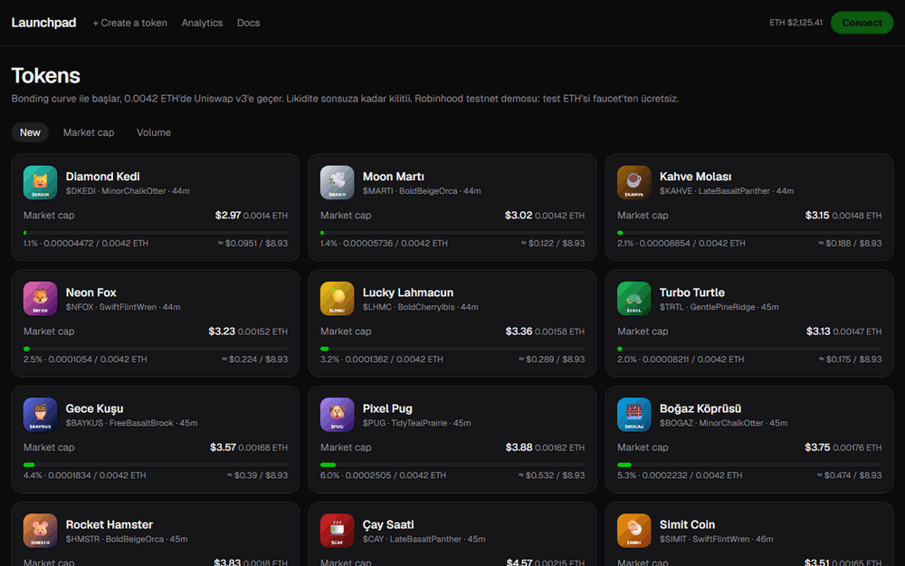
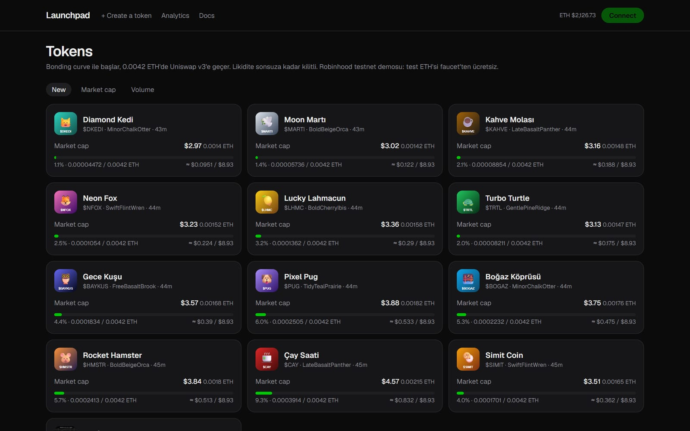
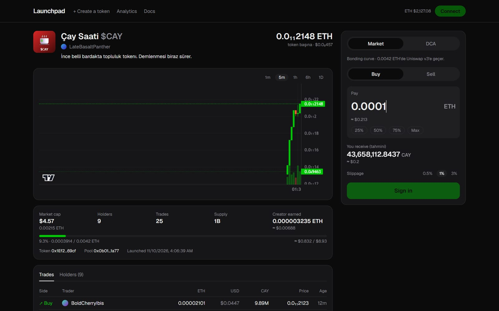
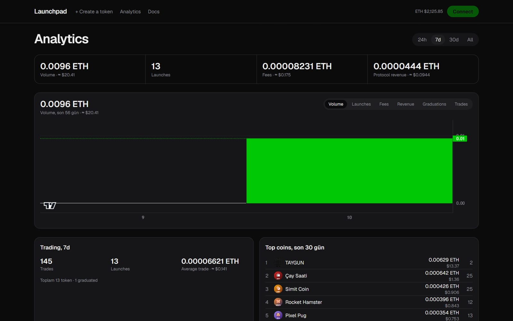
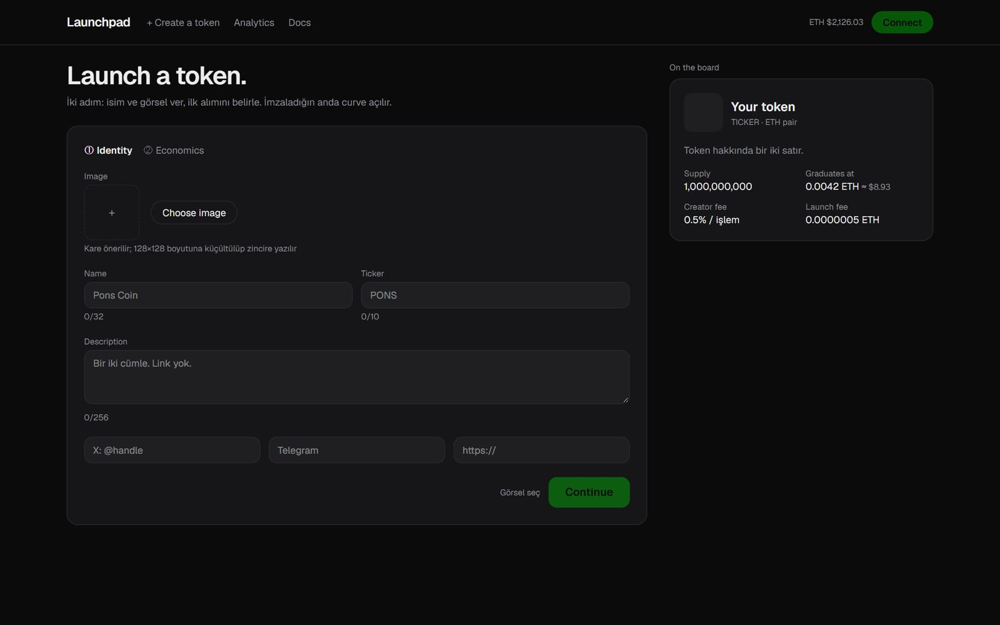

# Launchpad

🇬🇧 [English](README.md) · 🇹🇷 Türkçe

[](https://github.com/alisimsek55/launchpad/actions/workflows/ci.yml) [](LICENSE)   

**Robinhood Chain** (bir Arbitrum Orbit L2) üzerinde, pump.fun tarzında bonding curve tabanlı bir token launchpad'i. Herkes birkaç saniyede token çıkarabilir. Token önce bonding curve'de işlem görür; curve hedefine ulaşınca (mainnet'te 4.2 ETH, testnet'te 0.0042) likidite **otomatik olarak Uniswap v3'e taşınır** ve LP pozisyonu **sonsuza kadar kilitlenir**.

**🔗 Canlı demo (Robinhood Chain testnet): https://launchpad-cyan-nu.vercel.app**



> ⚠️ Öğrenme / portföy projesi. Sözleşmeler bağımsız bir denetimden (audit) geçmedi. Herkese açık demo **testnet**'te çalışır; gerçek parayla kullanmayın.

## Neler yapıyor

| | |
|---|---|
|  |  |
| **Token listesi:** canlı market cap (USD + ETH), curve ilerlemesi, yeni / market cap / hacme göre sıralama | **Token sayfası:** TradingView mumları, canlı teklif ve slippage ile alım-satım, işlemler ve holder'lar |
|  |  |
| **Analytics:** protokol hacmi, fee'ler, lansmanlar, graduation'lar, en iyi tokenlar | **Token oluşturma:** iki adımlı lansman; görsel ve metadata **tamamen zincir üstünde** |

- **Bonding curve:** sanal rezervli `x·y=k`; arzın %80'i curve'de satılır, %20'si Uniswap pool'unu besler. Graduation fiyatı Uniswap açılış fiyatına birebir eşittir, taşınma anında fiyat sıçraması olmaz.
- **Tek işlemde graduation:** Curve'ü tamamlayan alım, full-range Uniswap v3 pozisyonunu da oluşturur ve LP NFT'sini `LPLocker`'a kilitler. Creator likiditeyi çekemez (rug pull yok). Saldırgan pool fiyatını sınırlı tek adımda düzeltilemeyecek kadar uzaklaştırdıysa graduation *bekleyen* duruma geçer: curve kapanır, varlıklar `Graduator`'da bekler ve LP açılana kadar herkes `continueGraduation(token)` çağırabilir (token sayfasında "Graduation'ı tamamla" düğmesi).
- **Adil başlangıç:** ilk 60 saniyede sniper fee'si %20'den %1'e düşer; creator'ın lansman alımı arzın %5'iyle sınırlıdır.
- **Fee:** işlem başına %1, protokol ve creator arasında yarı yarıya. Graduation sonrası Uniswap LP fee'leri de aynı şekilde bölünür. Creator kazancını başka bir adrese çekebilir (`claimCreatorFees(recipient)`).
- **DCA:** kullanıcılar periyodik alım planlar; bir keeper (GitHub Actions cron) bunları curve'de veya Uniswap'te çalıştırır. Uniswap'te pool fiyatı 5 dakikalık TWAP'ın ~%5'ten fazla üstündeyse alım yapılmaz; pool'un fiyat geçmişi yetersizse tek koruma planın `maxPrice`'ıdır (`maxPrice` yoksa alım yok). Plan iptalinde iade başka adrese gönderilebilir (`cancelPlan(id, recipient)`).
- **Entegrasyonlar:** USD fiyatları (Coinbase, yedek CoinGecko) ve agregatörler için bir [DEX Screener Adapter](#dexscreener-entegrasyonu) API'si.

## Mimari

```
                 ┌──────────── Robinhood Chain (testnet 46630) ─────────────┐
 Tarayıcı ──tx──▶│ TokenFactory · BondingCurve · Graduator · LPLocker       │
 (MetaMask)      │ FeeVault · DCAVault · LaunchToken · Uniswap v3 (kendi)   │
    │            └───────────────┬──────────────────────────────────────────┘
    │                   event'ler │                       ▲ execute (30 dk'da bir)
    ▼                            ▼                       │
 Next.js (Vercel) ◀──REST── Ponder indexer (Render) ── Neon Postgres
                                                     GitHub Actions keeper
```

| Paket | Teknoloji | İçerik |
|---|---|---|
| `packages/contracts` | Solidity 0.8, Foundry, OpenZeppelin | 7 sözleşme; mainnet fork'ta koşan 40 test (unit, fuzz, invariant); deploy script'leri |
| `packages/shared` | TypeScript | Zincir tanımları, deploy adresleri, Solidity ile birebir aynı curve matematiği, üretilmiş ABI'ler |
| `apps/indexer` | Ponder, Hono, Postgres | Tokenlar, işlemler, OHLC mumları, holder'lar, analytics; REST + GraphQL + DEX Screener API |
| `apps/web` | Next.js 16, React 19, wagmi/viem, Tailwind, Lightweight Charts | Alım-satım arayüzü, token oluşturma, profil, analytics, docs |
| `apps/keeper` | Node, viem | DCA keeper (cron için `--once` modu) ve demo verisi script'i |
| `packages/subgraph` | The Graph | İsteğe bağlı Goldsky subgraph (web kullanmıyor) |

**Her şey ücretsiz planlarda çalışıyor:** Vercel Hobby (web), Render free (indexer), Neon free (Postgres), GitHub Actions (keeper + CI). Token metadata'sı zincir üstünde `data:` URI olarak durur, dosya deposu gerekmez. Gerekçe: [reports/2026-11-09-ucretsiz-mimari.md](reports/2026-11-09-ucretsiz-mimari.md). Diğer kararlar: [notes.md](notes.md), [reports/](reports/). Sabitler: [const.md](const.md).

## Mühendislik notları

Dokümantasyonu okumanın yetmediği problemler:

- **Arbitrum'da `block.number` sandığın şey değil.** Robinhood Chain'de Solidity'nin `block.number`'ı *L1* bloğunu döndürür. Bunu indexer'ın başlangıç bloğu olarak kaydeden bir deploy script'i, indexer'a başka bir zincirin blok numarasını verirdi. Script'ler L2 bloğunu RPC'den (`eth_blockNumber`) okuyor.
- **Graduation'ı sonsuza kadar engelleyebilecek bir saldırı.** Uniswap pool'u lansmanda oluşturulduğu için bir saldırgan, graduation'dan önce fiyatını hedeften uzaklaştırabilir. Graduator fiyatı bir swap ile düzeltir. Ama tek taraflı derin likidite koyan bir saldırgan, bu swap'ın bütün token'ları tüketip revert etmesine yol açabiliyordu. Çözüm: düzeltme swap'ı bakiyenin en fazla yarısını kullanır. Bir fuzz testi (`Manipulation.t.sol`) rastgele manipülasyonlarla bunu sınar. İkinci bir varyant, fiyat aralığını çok sayıda initialized tick ile doldurup düzeltme swap'ını blok gas limitinin üstüne çıkarabiliyordu; düzeltme artık işlem başına en fazla 200 tick geçer ve `continueGraduation` ile kaldığı yerden sürer (`GraduationDos.t.sol`). Graduation'a kadar pool'a token transferi de engellidir.
- **Saniyede 7 blok üreten bir zincirin gerisinde kalan indexer.** Canlı indexer zincirin giderek daha gerisine düşüyordu: Oregon'daki servis her blokta Londra'daki veritabanına yazıyordu (üretilen ~7 bloğa karşı saniyede ~2 blok). Yerelde ölçtüm (saniyede 9 blok), servisi veritabanının yanına (Frankfurt) taşıdım ve her bloktaki RPC önbellek yazmalarını kapattım. Artık her şeyi başlangıç bloğundan ~3 dakikada yeniden indeksliyor.
- **Tek curve, iki dil.** Fiyat matematiği hem Solidity'de (zincir üstü) hem TypeScript'te (arayüz teklifleri) var. İkisi aynı yuvarlamayı kullanır ve Solidity testleri TypeScript sonuçlarını referans değer olarak kontrol eder. Böylece ikisi birbirinden sapamaz.
- **Uniswap olmayan bir ağa Uniswap v3 kurmak.** Robinhood testnet'inde Uniswap yok. Testnet deploy script'i v3'ü resmi npm bytecode artefaktlarından kuruyor. Pool init code hash'i resmi olanla aynı olduğu için pool adresleri standart yöntemle hesaplanabiliyor.
- **Alım-satım arayüzünde önemli küçük detaylar:** mumlar işlem öncesi spot fiyattan açılır, böylece tek bir işlem de gerçek bir mum çizer. Uniswap multicall'larında gas tahmini yetmediği için swap işlemine %20 gas payı eklenir. Graduate olmuş tokenların teklifi QuoterV2 üzerinden alınır.

## Gereksinimler
- Node 24+, pnpm 12+
- Foundry (`foundryup`)

## Kurulum
```bash
git clone --recurse-submodules https://github.com/alisimsek55/launchpad.git
cd launchpad
pnpm install
```

## Yerel geliştirme (anvil fork, tüm sistem)
Gerçek ağın yerel kopyasında sözleşmeler + örnek veri + indexer + site. Her komut ayrı terminalde:

1. Yerel zincir (1 sn blok süresi):
```bash
anvil --fork-url https://rpc.mainnet.chain.robinhood.com --block-time 1
```
2. Deploy + örnek tokenlar (adresleri `packages/shared/deployments/local.json`'a yazar):
```bash
cd packages/contracts && forge script script/Simulate.s.sol --rpc-url http://127.0.0.1:8545 --broadcast --slow
```
3. Indexer ve site:
```bash
cd apps/indexer && rm -rf .ponder && LAUNCHPAD_NETWORK=local npx ponder dev
```
```bash
pnpm --filter @launchpad/web dev
```
4. (İsteğe bağlı) DCA keeper; yerelde anvil hesabı #0 yetkili (herkese açık test anahtarı, sadece yerelde):
```bash
cd apps/keeper && LAUNCHPAD_NETWORK=local POLL_MS=5000 KEEPER_PRIVATE_KEY=0xac0974bec39a17e36ba4a6b4d238ff944bacb478cbed5efcae784d7bf4f2ff80 npx tsx src/index.ts
```
`http://localhost:3000` → **Connect** yerelde anvil test hesabını bağlar.

## Testnet'e ücretsiz yayın
Adım adım rehber: [reports/testnet-deploy.md](reports/testnet-deploy.md). Özet: faucet'ten test ETH'si → `DeployTestnet.s.sol` (kendi Uniswap v3'ümüzü de kurar) → indexer Render + Neon → web Vercel → keeper GitHub Actions secret'ı.

## DexScreener entegrasyonu
Indexer, [DEX Screener Adapter spesifikasyonunu (v1.1)](https://dexscreener.notion.site/DEX-Screener-Adapter-Specs-cc1223cdf6e74a7799599106b65dcd0e) uygular; DexScreener ve aynı formatı okuyan agregatörler (GMGN vb.) curve ve Uniswap işlemlerini buradan çeker. Kod: `apps/indexer/src/api/dexscreener.ts`.

| Uç nokta | Açıklama |
| --- | --- |
| `GET /dexscreener/latest-block` | Ponder'ın tamamen işlediği son blok |
| `GET /dexscreener/asset?id=<adres>` | Token (ad, sembol, toplam ve dolaşımdaki arz) veya WETH |
| `GET /dexscreener/pair?id=<adres>` | Curve veya Uniswap v3 pair'i |
| `GET /dexscreener/events?fromBlock=&toBlock=` | `swap`, `join` ve `exit` event'leri (iki sınır da dahil; istek başına en fazla 10.000 blok ve 5.000 event, aşılırsa 400) |

Testnet adresi: `https://launchpad-indexer-nzgy.onrender.com/dexscreener/latest-block`

Kararlar:
- **Pair id:** Bonding curve aşamasında pair id **token adresidir**. Bütün curve'ler tek bir `BondingCurve` kontratında yaşar, curve'e özel kontrat adresi yoktur; token adresi her curve'ü tekil ve kalıcı olarak tanımlar (`dexKey: "launchpad"`). Graduation sonrası pair id **Uniswap v3 pool adresidir** (`dexKey: "uniswap"`). İkisi DexScreener'da aynı token'ın iki ayrı pair'i olarak görünür.
- **Sıra:** `asset0` Uniswap kuralıyla küçük adrestir (token veya WETH), iki pair'de de aynı. `priceNative` = 1 asset0'ın asset1 cinsinden fiyatı (işlem sonrası spot), 50 ondalığa kadar kesin.
- **Rezervler:** Curve'de **gerçek** rezervler (curve'deki ETH ve satılmamış curve arzı); sanal rezervler likiditeyi şişirirdi. v3 pool'unda rezervler pool'un **muhasebe bakiyeleridir**: iki taraf da pool'un `Mint`/`Collect`/`Swap`/`Flash` event'lerinden izlenir. Pool'a event'siz doğrudan gönderilen token/WETH (bağış) sayılmaz; v3 bunları likiditeye katmaz ve WETH tarafında bunu görmek için tüm WETH Transfer'larını dinlemek gerekirdi. Tam aralık `L/√P`, `L·√P` formülü kullanılmaz; üçüncü taraflar dar aralıklı likidite eklediğinde aktif likidite (L) pool bakiyesini göstermez.
- **Graduation:** Curve pair'i için `exit` (rezervler 0'a iner), pool için `join` (ilk likidite) event'i yayınlanır. Spec bir blokta `(txnIndex, eventIndex)` çiftinin tekil olmasını istediği için ikisi aynı tx'in farklı log'larına bağlanır.
- `/events`, henüz indekslenmemiş bir `toBlock` için 400 döner. DexScreener her bloğu bir kez sorduğu için boş yanıt veri kaybı olurdu. Aynı sebeple satır sınırı aşılınca yanıt kesilmez, 400 döner ve istemci aralığı daraltır.

**Listeleme:** Testnet zincirleri DexScreener'da listelenmez. Başvuru (DexScreener'a adapter adresini bildirmek) mainnet'e geçince yapılacak.

## Demo verisi
Canlı demo boş görünmesin diye testnet'e örnek tokenlar ve işlemler basan script (sadece testnet/local):
```bash
pnpm --filter @launchpad/keeper seed init    # demo cüzdanları (.seed-wallets.json, gitignore'da)
pnpm --filter @launchpad/keeper seed run     # fonla → 12 token oluştur → DURATION_MIN dk işlem
pnpm --filter @launchpad/keeper seed trade   # mevcut demo tokenlarında yeni işlem turu
```

## Komutlar
```bash
pnpm --filter @launchpad/contracts test       # Solidity testleri (mainnet fork, ~3 dk)
pnpm --filter @launchpad/contracts test:fast  # invariant hariç (~15 sn)
pnpm --filter @launchpad/contracts abis       # sözleşme değişince ABI'leri aktar
pnpm --filter @launchpad/shared test          # curve matematiği testleri
pnpm build                                    # tüm paketleri derle
```

## Ortam değişkenleri
Şablon: [env.example](env.example). Gizli değerler `.env`'ye veya barındırma panellerine girilir; repoya girmez.

## Nasıl geliştirildi

[Ali Şimşek](https://github.com/alisimsek55) tarafından, AI pair programmer olarak [Claude Code](https://claude.com/claude-code) ile geliştirildi. Ürün yönünü ben belirledim, kararları inceledim ve ana akışları gerçek bir cüzdanla canlı ağda test ettim; kodun büyük kısmını AI yazdı. Tasarımın nasıl evrildiği commit geçmişinde ve `reports/` klasöründe görülebilir.

## Lisans
[MIT](LICENSE)
